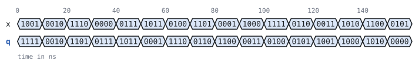

# 7.17 wave_puzzle_vec

**New concept:** when there's no formula, the table *is* the design.

Some functions have no simple formula: the trace is the only specification. A
constant array indexed by the input reproduces it exactly.

**Coming from Verilog:** A `localparam` lookup array; in VHDL, declare an array type and a constant.

## Task

Reproduce this trace exactly:

| time | x | q |
|---|---|---|
| 0 ns | `1001` | `1111` |
| 10 ns | `0010` | `0010` |
| 20 ns | `1110` | `1101` |
| 30 ns | `0000` | `0111` |
| 40 ns | `0111` | `1011` |
| 50 ns | `1011` | `0001` |
| 60 ns | `0100` | `1110` |
| 70 ns | `1101` | `0110` |
| 80 ns | `0001` | `1100` |
| 90 ns | `1000` | `0011` |
| 100 ns | `1111` | `0100` |
| 110 ns | `0110` | `0101` |
| 120 ns | `0011` | `1001` |
| 130 ns | `1010` | `1000` |
| 140 ns | `1100` | `1010` |
| 150 ns | `0101` | `0000` |



## Ports

```vhdl
entity top_module is
  port (
    x : in  std_logic_vector(3 downto 0);
    q : out std_logic_vector(3 downto 0)
  );
end entity top_module;
```

## Hints

<details><summary>Hint 1</summary>

Sort the samples by `x` and write a 16-entry constant array or `case`.

</details>

## Check

```
./check.py 7.17
```
