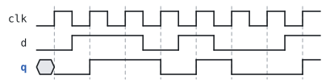

# 8.1 dff

**New concept:** the D flip-flop.

The canonical register: a process sensitive to the clock, with everything inside
`if rising_edge(clk)`.

```vhdl
process(clk)
begin
  if rising_edge(clk) then
    held <= sample;
  end if;
end process;
```

`clk'event and clk = '1'` is an older spelling you'll see in legacy code;
`rising_edge` is preferred because it ignores `'X'`→`'1'` and similar transitions.

**Coming from Verilog:** `always @(posedge clk) q <= d;`

## Task

A single D flip-flop: `q` takes the value of `d` at every rising edge of `clk`.



## Ports

```vhdl
entity top_module is
  port (
    clk, d : in  std_logic;
    q      : out std_logic
  );
end entity top_module;
```

## Hints

<details><summary>Hint 1</summary>

Five lines: `process(clk)`, `begin`, `if rising_edge(clk) then`, `q <= d;`, and the closing `end`s.

</details>

## Check

```
./check.py 8.1
```
