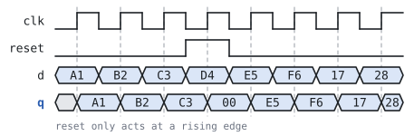

# 8.2 dff8_sync_reset

**New concept:** synchronous reset, checked inside `rising_edge`.

A **synchronous** reset only acts on a clock edge, so it goes *inside* the
`rising_edge` test:

```vhdl
if rising_edge(clk) then
  if clear = '1' then
    total <= (others => '0');
  else
    total <= next_total;
  end if;
end if;
```

The sensitivity list stays `process(clk)`: nothing happens between edges.

**Coming from Verilog:** `always @(posedge clk) if (reset) q <= 0; else q <= d;`

## Task

8 flip-flops with an active-high **synchronous** `reset` to `x"00"`.



## Ports

```vhdl
entity top_module is
  port (
    clk, reset : in  std_logic;
    d          : in  std_logic_vector(7 downto 0);
    q          : out std_logic_vector(7 downto 0)
  );
end entity top_module;
```

## Hints

<details><summary>Hint 1</summary>

Reset is checked inside `if rising_edge(clk)`.

</details>

## Check

```
./check.py 8.2
```
