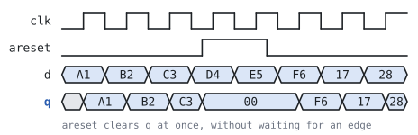

# 8.3 dff8_async_reset

**New concept:** async reset in the sensitivity list, `if reset = '1' then ... elsif rising_edge(clk)`.

An **asynchronous** reset acts immediately, without waiting for a clock edge. It
goes in the sensitivity list and is tested *before* the clock:

```vhdl
process(clk, rst)
begin
  if rst = '1' then
    state <= IDLE;
  elsif rising_edge(clk) then
    state <= next_state;
  end if;
end process;
```

The grader compares outputs in the middle of each cycle too, so a synchronous
implementation fails here: its output only clears at the next edge.

**Coming from Verilog:** `always @(posedge clk or posedge areset)` becomes `process(clk, areset)` with the reset tested first.

## Task

Same as 8.2, but the active-high reset `areset` is **asynchronous**.



## Ports

```vhdl
entity top_module is
  port (
    clk, areset : in  std_logic;
    d           : in  std_logic_vector(7 downto 0);
    q           : out std_logic_vector(7 downto 0)
  );
end entity top_module;
```

## Hints

<details><summary>Hint 1</summary>

`if areset = '1' then ... elsif rising_edge(clk) then ... end if;`

</details>

## Check

```
./check.py 8.3
```
