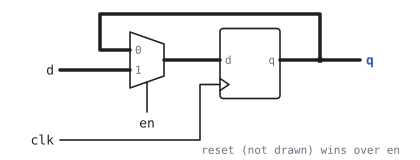

# 8.4 dff_enable

**New concept:** clock enable (not clock gating).

To make a register update only sometimes, use an **enable** inside the clocked
process. Never gate the clock itself (`clk and en`): that creates glitches and
timing problems in an FPGA.

```vhdl
if rising_edge(clk) then
  if load = '1' then
    cfg <= cfg_in;
  end if;           -- otherwise cfg keeps its value: that's what a register does
end if;
```

A missing `else` in a *clocked* process is fine: it means "hold". (It's only a
latch problem in combinational processes.)

**Coming from Verilog:** `if (en) q <= d;` inside `always @(posedge clk)`.

## Task

8-bit register with active-high synchronous `reset` to 0. Load `d` only when `en = '1'`. Reset has priority over the enable.



## Ports

```vhdl
entity top_module is
  port (
    clk, reset, en : in  std_logic;
    d              : in  std_logic_vector(7 downto 0);
    q              : out std_logic_vector(7 downto 0)
  );
end entity top_module;
```

## Hints

<details><summary>Hint 1</summary>

`if reset = '1' then ... elsif en = '1' then ... end if;` inside the clock edge.

</details>

## Check

```
./check.py 8.4
```
