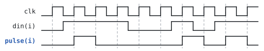

# 8.5 rise_detect

**New concept:** remembering the previous input.

An edge detector compares the input with a registered copy of itself:

```vhdl
if rising_edge(clk) then
  btn_d   <= btn;
  pressed <= btn and not btn_d;    -- btn_d is still last cycle's value here
end if;
```

Because `btn_d` is a signal, reading it in the same process gives the old value,
which is exactly what an edge detector needs.

**Coming from Verilog:** Same as two nonblocking assignments in one `always @(posedge clk)`.

## Task

For each of the 8 bits, `pulse(i)` is `'1'` for one cycle after the cycle in which
`din(i)` went from 0 to 1. `pulse` is a registered output: at each rising edge it
becomes `din and not (din at the previous edge)`.



## Ports

```vhdl
entity top_module is
  port (
    clk   : in  std_logic;
    din   : in  std_logic_vector(7 downto 0);
    pulse : out std_logic_vector(7 downto 0)
  );
end entity top_module;
```

## Hints

<details><summary>Hint 1</summary>

Bitwise operators handle all 8 bits at once.

</details>

## Check

```
./check.py 8.5
```
