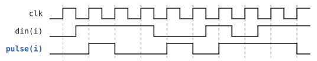

# 8.6 any_edge

**New concept:** detecting a change in either direction.

A change in either direction is the XOR of the current and previous values.

**Coming from Verilog:** `pulse <= din ^ prev;`

## Task

Same as 8.5, but `pulse(i)` flags both rising and falling edges of `din(i)`.



## Ports

```vhdl
entity top_module is
  port (
    clk   : in  std_logic;
    din   : in  std_logic_vector(7 downto 0);
    pulse : out std_logic_vector(7 downto 0)
  );
end entity top_module;
```

## Hints

<details><summary>Hint 1</summary>

Change one operator from 8.5.

</details>

## Check

```
./check.py 8.6
```
