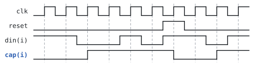

# 8.7 sticky_capture

**New concept:** set-dominant registers.

A **sticky** bit sets on an event and stays set until something clears it, like an
interrupt status register:

```vhdl
if rising_edge(clk) then
  if clear = '1' then
    status <= (others => '0');
  else
    status <= status or events;
  end if;
end if;
```

**Coming from Verilog:** Same pattern with `|`.

## Task

`cap(i)` goes high at the rising edge where a **falling** edge of `din(i)` is seen
(`din(i)` was `'1'` at the previous edge and is `'0'` now), and stays high until
reset. `reset` is synchronous and active-high, and it wins over a capture in the
same cycle.

The register holding the previous value of `din` is updated on every edge and
is **not** affected by `reset`.



## Ports

```vhdl
entity top_module is
  port (
    clk, reset : in  std_logic;
    din        : in  std_logic_vector(31 downto 0);
    cap        : out std_logic_vector(31 downto 0)
  );
end entity top_module;
```

## Hints

<details><summary>Hint 1</summary>

A falling edge is `prev and not din`.

</details>

<details><summary>Hint 2</summary>

`cap <= cap or (prev and not din);` unless reset.

</details>

## Check

```
./check.py 8.7
```
