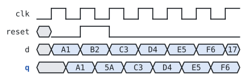

# 8.8 dff_negedge

**New concept:** `falling_edge(clk)`.

`falling_edge(clk)` works just like `rising_edge`. Designs that use both edges of
one clock are rare in FPGAs. They halve the time available for logic between the
two edges.

**Coming from Verilog:** `always @(negedge clk)`.

## Task

8-bit register with active-high synchronous `reset` to `x"5A"`, updating on the **falling** edge of `clk`.



## Ports

```vhdl
entity top_module is
  port (
    clk, reset : in  std_logic;
    d          : in  std_logic_vector(7 downto 0);
    q          : out std_logic_vector(7 downto 0)
  );
end entity top_module;
```

The grader changes inputs 1 ns after each falling edge for this problem, so they are stable when your register samples them.

## Hints

<details><summary>Hint 1</summary>

Replace `rising_edge` with `falling_edge` in 8.2.

</details>

## Check

```
./check.py 8.8
```
