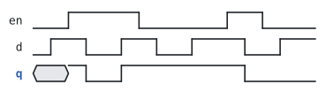

# 8.10 d_latch

**New concept:** what a latch is and why you usually don't want one.

A **latch** is transparent while its enable is high and holds while it's low. In a
process, it appears whenever an output isn't assigned on some path:

```vhdl
process(all)
begin
  if gate = '1' then
    held <= sample;     -- no else: held keeps its value when gate = '0'
  end if;
end process;
```

FPGA tools support latches but warn about them, because their timing is hard to
analyse and they are usually a bug (see 5.6 and 16.2). Here, for once, it's the
point.

There's no clock in this problem. The grader changes one input at a time and
compares after each change.

**Coming from Verilog:** Same as an incomplete `if` in `always @(*)`.

## Task

`q` follows `d` while `en = '1'` and holds its value while `en = '0'`.



## Ports

```vhdl
entity top_module is
  port (
    d, en : in  std_logic;
    q     : out std_logic
  );
end entity top_module;
```

## Hints

<details><summary>Hint 1</summary>

The process above, with your names.

</details>

## Check

```
./check.py 8.10
```
