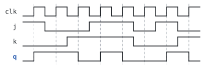

# 8.11 jk_ff

**New concept:** a flip-flop with a feedback-dependent next state, and signal initial values.

A signal declaration can give an **initial value**:

```vhdl
signal count : unsigned(3 downto 0) := (others => '0');
```

In simulation it's the value at time 0. On most FPGAs (Xilinx, Intel, Lattice)
synthesis also honors it as the power-up value of the register. ASICs ignore
initial values, so ASIC designs always need a reset.

Because an `out` port is readable in VHDL-2008, you *could* use `q` directly, but
a port can't have its own initial value here, so the stub gives you an internal
signal that starts at `'0'`.

**Coming from Verilog:** `reg q = 0;` is the same idea.

## Task

JK flip-flop. At each rising edge:

| j | k | next `q` |
|---|---|---|
| 0 | 0 | hold |
| 0 | 1 | `'0'` |
| 1 | 0 | `'1'` |
| 1 | 1 | toggle |

Use the internal signal `q_int` (initialized to `'0'`) as the state.



## Ports

```vhdl
entity top_module is
  port (
    clk, j, k : in  std_logic;
    q         : out std_logic
  );
end entity top_module;
```

## Hints

<details><summary>Hint 1</summary>

A `case` on `std_logic_vector'(j & k)` inside the clock edge.

</details>

## Check

```
./check.py 8.11
```
