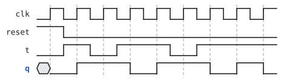

# 8.12 t_ff

**New concept:** toggling from the current state.

A toggle flip-flop inverts its state when `t = '1'`. The next state depends on
the current one, so the process reads back the signal it assigns. That's fine
for a register: the read gives last cycle's value.

**Coming from Verilog:** `q <= q ^ t;`

## Task

Toggle flip-flop: at each rising edge, `q` inverts when `t = '1'` and holds otherwise. Active-high synchronous `reset` clears `q`.



## Ports

```vhdl
entity top_module is
  port (
    clk, reset, t : in  std_logic;
    q             : out std_logic
  );
end entity top_module;
```

## Hints

<details><summary>Hint 1</summary>

`q <= q xor t;` — VHDL-2008 lets you read the `out` port `q`.

</details>

## Check

```
./check.py 8.12
```
