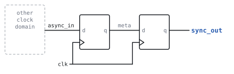

# 8.13 sync2

**New concept:** a two-flop synchronizer for a signal from another clock domain.

A signal from another clock domain (or a button) can change right at your clock
edge. The first flip-flop that samples it may go **metastable**: its output
hovers between 0 and 1 for an unpredictable time before settling. A second
flip-flop gives it a whole clock period to settle, making failures astronomically
rare.

Rules: only single-bit signals go through a plain synchronizer (multi-bit values
need a handshake or a FIFO), and nothing else may read the first stage.
Vendors also let you mark the pair (e.g. Xilinx `ASYNC_REG`) so placement keeps
them close.

In simulation, metastability doesn't exist. The grader only checks the two-cycle
delay.

**Coming from Verilog:** Same two-flop chain.

## Task

Pass `async_in` through two flip-flops to `sync_out`.



## Ports

```vhdl
entity top_module is
  port (
    clk, async_in : in  std_logic;
    sync_out      : out std_logic
  );
end entity top_module;
```

## Hints

<details><summary>Hint 1</summary>

An internal signal for the first stage; both assignments in one clocked process.

</details>

## Check

```
./check.py 8.13
```
