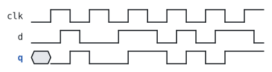

# 8.14 dual_edge

**New concept:** FPGAs don't have dual-edge flip-flops, so you build the behavior from two.

`if rising_edge(clk) or falling_edge(clk)` simulates, but no FPGA flip-flop can
implement it, and synthesis will reject it. The usual trick: one register on each
edge, and a mux driven by the clock selects whichever was updated most recently.

(Feeding a clock into logic is normally a bad idea; this is one of the few places
you'll see it.)

**Coming from Verilog:** `always @(posedge clk or negedge clk)` is not synthesizable either.

## Task

`q` takes the value of `d` on **both** edges of `clk`.



## Ports

```vhdl
entity top_module is
  port (
    clk, d : in  std_logic;
    q      : out std_logic
  );
end entity top_module;
```

For this problem the grader changes inputs 2.5 ns after each falling edge, away from both clock edges.

## Hints

<details><summary>Hint 1</summary>

One process on `rising_edge`, one on `falling_edge`, each with its own register.

</details>

<details><summary>Hint 2</summary>

`q <= q_pos when clk = '1' else q_neg;`

</details>

## Check

```
./check.py 8.14
```
