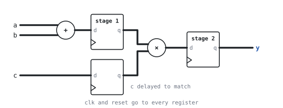

# 8.15 pipeline3

**New concept:** pipeline registers and latency.

A pipeline splits a long combinational path with registers so the clock can run
faster. Every value that travels alongside must be delayed by the same number of
stages, or the stages will mix data from different cycles.

```vhdl
if rising_edge(clk) then
  s1_sum <= x + z;      -- stage 1
  s1_k   <= k;          -- k travels with its sum
  s2_out <= s1_sum * s1_k;
end if;
```

**Coming from Verilog:** Same idea; the multiplication width rules from 6.11 apply.

## Task

Compute `y = (a + b) * c` (8-bit unsigned inputs, 17-bit result) with **exactly 2
cycles** of latency: register after the add and after the multiply. An active-high
synchronous `reset` clears every pipeline register to 0.



## Ports

```vhdl
entity top_module is
  port (
    clk, reset : in  std_logic;
    a, b, c    : in  std_logic_vector(7 downto 0);
    y          : out std_logic_vector(16 downto 0)
  );
end entity top_module;
```

## Hints

<details><summary>Hint 1</summary>

Stage 1: a 9-bit sum and a delayed copy of `c`. Stage 2: the 17-bit product.

</details>

<details><summary>Hint 2</summary>

9 bits × 8 bits = 17 bits.

</details>

## Check

```
./check.py 8.15
```
