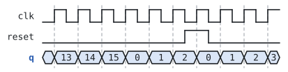

# 9.1 count16

**New concept:** an `unsigned` counter signal, `+ 1`, wraparound.

Keep the count in an internal `unsigned` signal, add 1 each clock, and convert to
`std_logic_vector` for the port. `unsigned` arithmetic wraps silently at its width:
`"1111" + 1` is `"0000"`.

```vhdl
signal ticks : unsigned(5 downto 0);
...
ticks <= ticks + 1;           -- inside if rising_edge(clk)
count_out <= std_logic_vector(ticks);
```

**Coming from Verilog:** `q <= q + 1;` works the same once `q` is `unsigned`; on a raw `std_logic_vector` there is no `+`.

## Task

A 4-bit counter `q` that counts 0–15 and wraps. Active-high synchronous `reset` to 0.



## Ports

```vhdl
entity top_module is
  port (
    clk, reset : in  std_logic;
    q          : out std_logic_vector(3 downto 0)
  );
end entity top_module;
```

## Hints

<details><summary>Hint 1</summary>

An `unsigned(3 downto 0)` signal, and `q <= std_logic_vector(cnt);` outside the process.

</details>

## Check

```
./check.py 9.1
```
