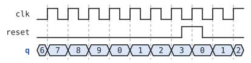

# 9.2 decade

**New concept:** wrapping at an arbitrary limit.

To wrap somewhere other than a power of two, compare before incrementing:

```vhdl
if minute = 59 then minute <= (others => '0'); else minute <= minute + 1; end if;
```

`unsigned = integer` comparisons are defined in `numeric_std`.

**Coming from Verilog:** Same comparison; no casting needed once the signal is `unsigned`.

## Task

A counter `q` that counts 0–9 and wraps. Active-high synchronous `reset` to 0.



## Ports

```vhdl
entity top_module is
  port (
    clk, reset : in  std_logic;
    q          : out std_logic_vector(3 downto 0)
  );
end entity top_module;
```

## Hints

<details><summary>Hint 1</summary>

`if cnt = 9 then cnt <= (others => '0'); else cnt <= cnt + 1; end if;`

</details>

## Check

```
./check.py 9.2
```
