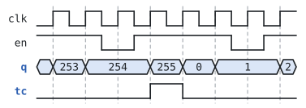

# 9.3 count_en_tc

**New concept:** enable + terminal-count output.

A **terminal count** output tells the next counter in a chain "I'm about to wrap".
Qualifying it with the enable makes chains work: the next stage should only
advance when this stage actually wraps.

```vhdl
carry_out <= '1' when cnt = 15 and step = '1' else '0';
```

That's a combinational output from the register and the current input.

**Coming from Verilog:** `assign tc = (q == 8'hFF) && en;`

## Task

8-bit counter `q` with active-high synchronous `reset` and an enable `en`: it
increments (wrapping 255 → 0) only on edges where `en = '1'`. `tc` is `'1'`
combinationally when `q = 255` **and** `en = '1'`.



## Ports

```vhdl
entity top_module is
  port (
    clk, reset, en : in  std_logic;
    q              : out std_logic_vector(7 downto 0);
    tc             : out std_logic
  );
end entity top_module;
```

## Hints

<details><summary>Hint 1</summary>

`tc` is a concurrent assignment outside the clocked process.

</details>

## Check

```
./check.py 9.3
```
