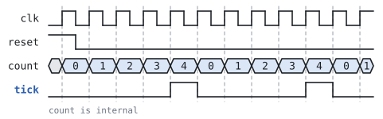

# 9.4 tick_gen

**New concept:** clock-enable pulse generation (the right way to get a slow clock).

To run part of a design slower, don't divide the clock: generate a one-cycle
**enable pulse** at the slower rate and keep everything on the fast clock. That
keeps the design in one clock domain.

A free-running modulo-N counter gives one pulse per N cycles.

**Coming from Verilog:** Same technique. Avoid `always @(posedge slow_clk)` with a derived clock.

## Task

`tick` is `'1'` for exactly one cycle out of every 5. Use a counter that resets to
0 and counts 0, 1, 2, 3, 4, 0, …, and make `tick` `'1'` while the counter is 4.

So after the reset edge, the counter is 0 during the first cycle and `tick` is
high during the 5th cycle. `tick` depends only on the counter, not on any input.
`reset` is active-high and synchronous.



## Ports

```vhdl
entity top_module is
  port (
    clk, reset : in  std_logic;
    tick       : out std_logic
  );
end entity top_module;
```

## Hints

<details><summary>Hint 1</summary>

A `0 to 4` counter and `tick <= '1' when cnt = 4 else '0';`

</details>

## Check

```
./check.py 9.4
```
