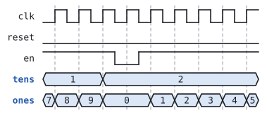

# 9.5 bcd_counter2

**New concept:** cascading counters with enables.

Counters chain by enables: the second stage advances when the first stage is
about to wrap *and* is enabled. Everything stays on the same clock.

**Coming from Verilog:** Same structure: no ripple clocks.

## Task

A two-digit BCD counter 00–99 that wraps to 00, with active-high synchronous
`reset`. On each edge with `en = '1'`, `ones` increments (9 → 0); when `ones` rolls
over from 9 to 0, `tens` increments as well (9 → 0). Nothing changes when
`en = '0'`.



## Ports

```vhdl
entity top_module is
  port (
    clk, reset, en : in  std_logic;
    ones, tens     : out std_logic_vector(3 downto 0)
  );
end entity top_module;
```

## Hints

<details><summary>Hint 1</summary>

`tens` advances when `en = '1'` and `ones = 9`.

</details>

## Check

```
./check.py 9.5
```
