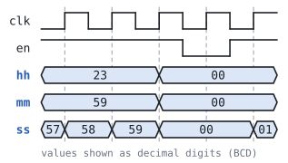

# 9.6 clock_hms

**New concept:** chained counters with different moduli.

A clock is a chain of BCD counters with different wrap points: seconds and
minutes wrap at 59, hours at 23. Each two-digit field is its own
ones/tens pair, and the carries chain all the way up.

Hours are the tricky field: the tens digit wraps at 2, but the ones digit then
wraps at 3 instead of 9.

**Coming from Verilog:** Same structure.

## Task

A 24-hour clock in BCD: `hh` 00–23, `mm` 00–59, `ss` 00–59, each as two BCD digits
(`hh(7 downto 4)` is the tens digit). It advances one second on each edge where
`en = '1'`; 23:59:59 rolls over to 00:00:00. Active-high synchronous `reset` to
00:00:00.



## Ports

```vhdl
entity top_module is
  port (
    clk, reset, en : in  std_logic;
    hh, mm, ss     : out std_logic_vector(7 downto 0)
  );
end entity top_module;
```

The grader runs 100k cycles so that the hours roll over at least once.

## Hints

<details><summary>Hint 1</summary>

Write a small helper: a function that increments a BCD pair with a given maximum, or nest `if`s.

</details>

<details><summary>Hint 2</summary>

Seconds wrap at x"59"; minutes advance only when seconds wrap; hours only when both do.

</details>

## Check

```
./check.py 9.6
```
