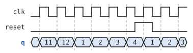

# 9.7 count_1_to_12

**New concept:** a counter that doesn't start at zero.

Not every counter starts at 0. The reset value and the wrap value are both just
constants.

**Coming from Verilog:** Same.

## Task

A counter that counts 1, 2, …, 12, 1, … with active-high synchronous `reset` to 1.



## Ports

```vhdl
entity top_module is
  port (
    clk, reset : in  std_logic;
    q          : out std_logic_vector(3 downto 0)
  );
end entity top_module;
```

## Hints

<details><summary>Hint 1</summary>

Reset to 1, and wrap from 12 to 1.

</details>

## Check

```
./check.py 9.7
```
