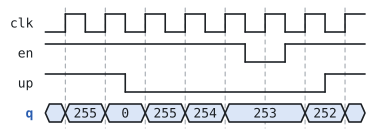

# 9.8 updown

**New concept:** two directions of wraparound.

`unsigned` wraps both ways: `"00000000" - 1` is `"11111111"`.

**Coming from Verilog:** Same.

## Task

8-bit up/down counter `q`. When `en = '1'`, it counts up if `up = '1'` and down otherwise, wrapping both ways. Holds when `en = '0'`. Active-high synchronous `reset` to 0.



## Ports

```vhdl
entity top_module is
  port (
    clk, reset, en, up : in  std_logic;
    q                  : out std_logic_vector(7 downto 0)
  );
end entity top_module;
```

## Hints

<details><summary>Hint 1</summary>

Nested `if`s: reset, then enable, then direction.

</details>

## Check

```
./check.py 9.8
```
