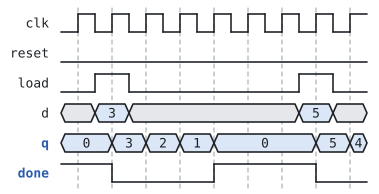

# 9.9 countdown_timer

**New concept:** load + count down + done flag.

A down-counter with a parallel load is the core of most timers: load the duration,
count down, raise a flag at zero.

**Coming from Verilog:** Same.

## Task

On an edge where `load = '1'`, `q` loads `d`. Otherwise it decrements while it is
nonzero and stops at 0. `done` is `'1'` while `q` is 0 (it depends only on `q`).
Active-high synchronous `reset` sets `q` to 0 and has priority over `load`.



## Ports

```vhdl
entity top_module is
  port (
    clk, reset, load : in  std_logic;
    d                : in  std_logic_vector(7 downto 0);
    q                : out std_logic_vector(7 downto 0);
    done             : out std_logic
  );
end entity top_module;
```

## Hints

<details><summary>Hint 1</summary>

`elsif cnt /= 0 then cnt <= cnt - 1;`

</details>

## Check

```
./check.py 9.9
```
