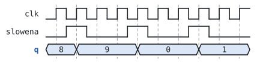

# 9.10 decade_slowena

**New concept:** a counter driven by a slow enable.

Combine 9.2 with an enable: this is the building block of every divider chain,
driven by a tick like the one from 9.4.

**Coming from Verilog:** Same.

## Task

Decade counter `q` (0–9, wraps) that advances only on edges where `slowena = '1'`. Active-high synchronous `reset` to 0.



## Ports

```vhdl
entity top_module is
  port (
    clk, reset, slowena : in  std_logic;
    q                   : out std_logic_vector(3 downto 0)
  );
end entity top_module;
```

## Hints

<details><summary>Hint 1</summary>

9.2 with the increment inside `if slowena = '1'`.

</details>

## Check

```
./check.py 9.10
```
