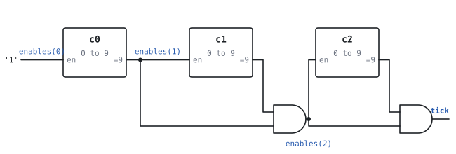

# 9.11 div1000_enables

**New concept:** building a divider from cascaded decade counters and exposing their enables.

Three decade counters in a chain divide by 1000. Stage 0 counts every cycle;
stage 1 advances when stage 0 is at 9; stage 2 when both stage 0 and stage 1 are
at 9. When all three are at 9, the next edge wraps them all, so that's when the
1000-cycle tick fires.

**Coming from Verilog:** Same structure.

## Task

Build three decade counters `c0`, `c1`, `c2` (each 0–9, all reset to 0 by the
active-high synchronous `reset`).

- `enables(0)` is always `'1'`: stage 0 counts every cycle.
- `enables(1)` is `'1'` when `c0 = 9`.
- `enables(2)` is `'1'` when `c0 = 9` and `c1 = 9`.
- `tick` is `'1'` when all three counters are 9.

Each stage increments (wrapping 9 → 0) on edges where its enable is `'1'`. The
outputs are combinational from the counter values, so `tick` is high for one
cycle in every 1000.



## Ports

```vhdl
entity top_module is
  port (
    clk, reset : in  std_logic;
    enables    : out std_logic_vector(2 downto 0);
    tick       : out std_logic
  );
end entity top_module;
```

## Hints

<details><summary>Hint 1</summary>

One process with three counters, plus concurrent assignments for the enables.

</details>

## Check

```
./check.py 9.11
```
