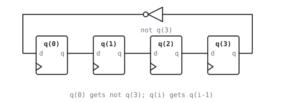

# 9.12 johnson4

**New concept:** a twisted-ring counter.

A **Johnson counter** is a shift register whose input is the inverted last bit.
An n-bit Johnson counter cycles through 2n states, and every step changes exactly
one bit, so decoding any state needs only a 2-input gate.

**Coming from Verilog:** `q <= {q[2:0], ~q[3]};`

## Task

4-bit Johnson counter: at each edge, `q` shifts left by one and the inverse of the
old `q(3)` enters at `q(0)`. Active-high synchronous `reset` to `"0000"`. The
sequence is `0000, 0001, 0011, 0111, 1111, 1110, 1100, 1000, 0000, …`



## Ports

```vhdl
entity top_module is
  port (
    clk, reset : in  std_logic;
    q          : out std_logic_vector(3 downto 0)
  );
end entity top_module;
```

## Hints

<details><summary>Hint 1</summary>

`q <= q(2 downto 0) & not q(3);`

</details>

## Check

```
./check.py 9.12
```
