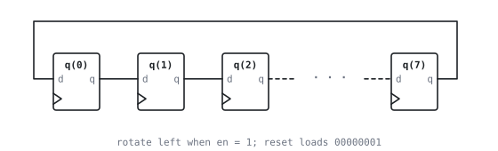

# 9.13 onehot_ring

**New concept:** a rotating one-hot token.

A ring counter rotates a single `'1'` around a register: each state is already
one-hot decoded, which makes it handy for sequencing.

**Coming from Verilog:** `q <= {q[6:0], q[7]};`

## Task

8-bit one-hot ring counter. Active-high synchronous `reset` to `"00000001"`. On each edge where `en = '1'`, rotate left by one (bit 7 wraps to bit 0).



## Ports

```vhdl
entity top_module is
  port (
    clk, reset, en : in  std_logic;
    q              : out std_logic_vector(7 downto 0)
  );
end entity top_module;
```

## Hints

<details><summary>Hint 1</summary>

`q(6 downto 0) & q(7)`, or `rotate_left` from `numeric_std` on an `unsigned`.

</details>

## Check

```
./check.py 9.13
```
