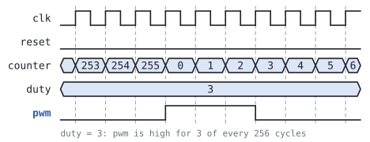

# 9.14 pwm8

**New concept:** a free-running counter compared against a duty value.

Pulse-width modulation: a counter runs freely, and the output is high while the
counter is below a threshold. The fraction of time spent high is
`duty / 256`.

**Coming from Verilog:** Same.

## Task

An 8-bit counter increments every cycle and wraps 255 → 0; active-high
synchronous `reset` clears it. `pwm` is `'1'` when `counter < duty`, compared
combinationally against the current `duty` input.



## Ports

```vhdl
entity top_module is
  port (
    clk, reset : in  std_logic;
    duty       : in  std_logic_vector(7 downto 0);
    pwm        : out std_logic
  );
end entity top_module;
```

## Hints

<details><summary>Hint 1</summary>

`pwm <= '1' when cnt < unsigned(duty) else '0';`

</details>

## Check

```
./check.py 9.14
```
