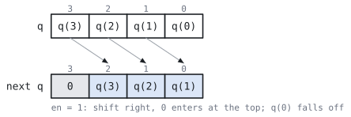

# 10.1 shift4

**New concept:** shifting via slice-and-concatenate.

A shift register is a register whose next value is a slice of itself plus a new
bit:

```vhdl
hist <= hist(6 downto 0) & sample;     -- shift left, new bit enters at the bottom
```

Priorities between controls are just the order of the `if`/`elsif` chain.

**Coming from Verilog:** `q <= {1'b0, q[3:1]};` becomes `q <= '0' & q(3 downto 1);`.

## Task

4-bit shift register `q` with:

- asynchronous active-high reset `areset` → `"0000"`
- `load = '1'`: load `d` (highest priority after reset)
- else `en = '1'`: shift right by one; the MSB fills with `'0'`
- otherwise hold



## Ports

```vhdl
entity top_module is
  port (
    clk, areset, load, en : in  std_logic;
    d                     : in  std_logic_vector(3 downto 0);
    q                     : out std_logic_vector(3 downto 0)
  );
end entity top_module;
```

## Hints

<details><summary>Hint 1</summary>

`if areset = '1' then ... elsif rising_edge(clk) then if load ... elsif en ...`

</details>

## Check

```
./check.py 10.1
```
