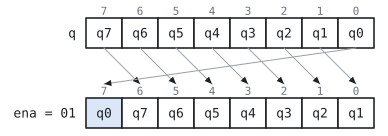
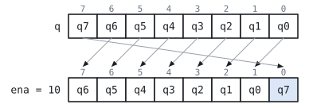

# 10.2 rotate8

**New concept:** `rotate_left`/`rotate_right` from `numeric_std`, or by hand.

A rotation moves the bit that falls off one end back in at the other.
`numeric_std` provides `rotate_left(x, n)` and `rotate_right(x, n)` for
`unsigned` and `signed`; with slices it's `v(0) & v(7 downto 1)` (right by one).

**Coming from Verilog:** `{q[0], q[7:1]}`.

## Task

8-bit register `q`, no reset. On an edge with `load = '1'`, load `d`. Otherwise
`ena = "01"` rotates right by one, `"10"` rotates left by one, and `"00"`/`"11"`
hold.





## Ports

```vhdl
entity top_module is
  port (
    clk, load : in  std_logic;
    ena       : in  std_logic_vector(1 downto 0);
    d         : in  std_logic_vector(7 downto 0);
    q         : out std_logic_vector(7 downto 0)
  );
end entity top_module;
```

With no reset, the grader asserts `load` in the first cycle so the register starts from a known value.

## Hints

<details><summary>Hint 1</summary>

A `case ena is` inside `elsif` of the load test.

</details>

## Check

```
./check.py 10.2
```
