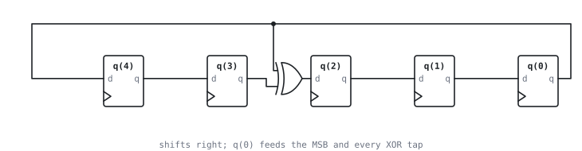

# 10.4 lfsr5

**New concept:** Galois LFSR.

A **linear feedback shift register** produces a pseudo-random sequence. In the
**Galois** form, the register shifts one way and the bit falling off the end is
XORed into a few fixed *tap* positions as it wraps around. With the right taps it
visits every non-zero state before repeating (2ⁿ − 1 states). The all-zero state
is a trap, so never reset to zero.

Tap positions are traditionally numbered from 1. A tap at position `n` (the
register width) is just the wrap-around itself.

**Coming from Verilog:** Same structure: a concatenation with a few XORs.

## Task

5-bit Galois LFSR with taps at positions 5 and 3 (period 31). At each edge the
register shifts **right**:

- `q(4)` gets the old `q(0)` (the wrap-around, tap 5)
- `q(2)` gets the old `q(3) XOR q(0)` (tap 3)
- every other bit gets its left neighbour: `q(3) ← q(4)`, `q(1) ← q(2)`, `q(0) ← q(1)`

Active-high synchronous `reset` to `"00001"`.



## Ports

```vhdl
entity top_module is
  port (
    clk, reset : in  std_logic;
    q          : out std_logic_vector(4 downto 0)
  );
end entity top_module;
```

## Hints

<details><summary>Hint 1</summary>

One concatenation: `q(0) & q(4) & (q(3) xor q(0)) & q(2) & q(1)`.

</details>

## Check

```
./check.py 10.4
```
