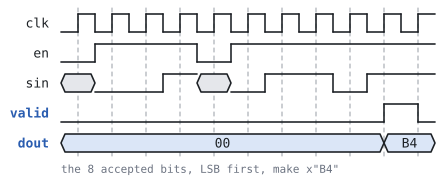

# 10.5 sipo8

**New concept:** serial-to-parallel with a bit counter.

Serial-in, parallel-out: shift bits in one at a time and count them. When a full
word has arrived, publish it and raise a one-cycle strobe. For **LSB-first**
data, shift right and enter new bits at the top, so the first bit ends up in
bit 0.

**Coming from Verilog:** Same structure.

## Task

On each edge with `en = '1'`, accept the bit on `sin` into a shift register
(LSB first). On the edge that accepts the 8th bit of a byte, copy the complete
byte to `dout` and set `valid` to `'1'`; `valid` is `'0'` after every other edge.
`dout` holds its value until the next byte completes.

Active-high synchronous `reset` clears the bit count, `dout` and `valid` to 0.



## Ports

```vhdl
entity top_module is
  port (
    clk, reset, en, sin : in  std_logic;
    dout                : out std_logic_vector(7 downto 0);
    valid               : out std_logic
  );
end entity top_module;
```

## Hints

<details><summary>Hint 1</summary>

A bit counter 0–7. On the 8th accepted bit the counter is 7, and the byte is `sin & sr(7 downto 1)`.

</details>

## Check

```
./check.py 10.5
```
