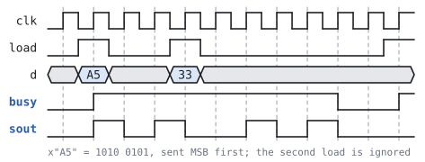

# 10.6 piso8

**New concept:** parallel-in serial-out with busy.

Parallel-in, serial-out: capture a word, then shift it out one bit per cycle while
flagging `busy`. A `busy` output lets the producer know when it may load again.

**Coming from Verilog:** Same structure.

## Task

While idle (`busy = '0'`), an edge with `load = '1'` captures `d`. During the next
8 cycles `busy = '1'` and `sout` shows `d(7)`, `d(6)`, …, `d(0)`, one bit per
cycle, MSB first. After those 8 cycles `busy` returns to `'0'` and `sout` to
`'0'`. `load` is ignored on edges where `busy = '1'`.

Active-high synchronous `reset` → idle, `sout = '0'`. Both outputs are registered.



## Ports

```vhdl
entity top_module is
  port (
    clk, reset, load : in  std_logic;
    d                : in  std_logic_vector(7 downto 0);
    sout, busy       : out std_logic
  );
end entity top_module;
```

## Hints

<details><summary>Hint 1</summary>

Keep a bits-remaining counter alongside the shift register.

</details>

<details><summary>Hint 2</summary>

On the load edge, `sout <= d(7)` and the register keeps the remaining 7 bits.

</details>

## Check

```
./check.py 10.6
```
