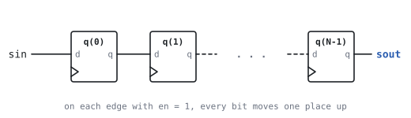

# 10.7 shift_n_generic

**New concept:** a generic-width shift register with serial in and out.

With a generic width, write slices in terms of the generic:
`q(N - 2 downto 0) & sin`.

**Coming from Verilog:** `parameter N` becomes a generic.

## Task

`generic (N: positive := 12)`. On each edge with `en = '1'`, shift `q` left by one
with `sin` entering at bit 0. `sout` is the MSB `q(N-1)`. No reset.



## Ports

```vhdl
entity top_module is
  generic (
    N : positive := 12
  );
  port (
    clk, en, sin : in  std_logic;
    sout         : out std_logic;
    q            : out std_logic_vector(N-1 downto 0)
  );
end entity top_module;
```

## Hints

<details><summary>Hint 1</summary>

Use an internal signal for the register so you can read it, or read the `out` port in VHDL-2008.

</details>

## Check

```
./check.py 10.7
```
