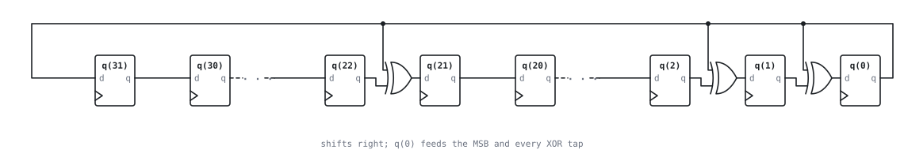

# 10.8 lfsr32

**New concept:** a wide Galois LFSR.

Same structure as 10.4, wider. Taps at 32, 22, 2, 1 give a maximal-length
sequence of 2³² − 1 states.

**Coming from Verilog:** Same structure.

## Task

32-bit Galois LFSR with taps at positions 32, 22, 2, 1. At each edge the register
shifts **right**, and the old `q(0)` is XORed in at each tap:

- `q(31)` gets the old `q(0)`
- `q(21)` gets `q(22) XOR q(0)`
- `q(1)` gets `q(2) XOR q(0)`
- `q(0)` gets `q(1) XOR q(0)`
- every other bit `q(i)` gets `q(i+1)`

Active-high synchronous `reset` to `x"00000001"`.



## Ports

```vhdl
entity top_module is
  port (
    clk, reset : in  std_logic;
    q          : out std_logic_vector(31 downto 0)
  );
end entity top_module;
```

## Hints

<details><summary>Hint 1</summary>

Shift first (`'0' & q(31 downto 1)`), then XOR a mask built from `q(0)`.

</details>

## Check

```
./check.py 10.8
```
