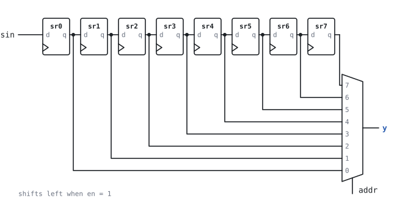

# 10.9 tap_lut

**New concept:** a shift register plus a read mux behaves like a LUT (this is how SRL primitives work).

Xilinx FPGAs can configure a LUT as a 16- or 32-bit shift register with an
addressable output (SRL16/SRL32). Describe exactly that and synthesis maps it to
one LUT instead of a chain of flip-flops: a shift register with no reset plus a
mux.

**Coming from Verilog:** Same.

## Task

An 8-bit shift register `sr` shifts left on each edge with `en = '1'`, with `sin`
entering at bit 0. The output `y = sr(addr)`, read combinationally. No reset.



## Ports

```vhdl
entity top_module is
  port (
    clk, en, sin : in  std_logic;
    addr         : in  std_logic_vector(2 downto 0);
    y            : out std_logic
  );
end entity top_module;
```

## Hints

<details><summary>Hint 1</summary>

`y <= sr(to_integer(unsigned(addr)));`

</details>

## Check

```
./check.py 10.9
```
