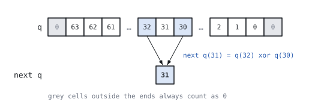

# 10.10 rule90

**New concept:** a 1-D cellular automaton; every cell updates in parallel.

A cellular automaton updates every cell at once from its neighbours. Because a
clocked process computes *all* next values from the *old* register, parallel
update comes for free. Out-of-range neighbours are handled with padding:

```vhdl
padded := '0' & cells & '0';     -- now padded(i+2) and padded(i) are the neighbours of cells(i)
```

**Coming from Verilog:** Same as an XOR of two shifted copies.

## Task

64 cells in `q`. On an edge with `load = '1'`, load `d`. Otherwise each cell
becomes `left XOR right`, where `left` is `q(i+1)` and `right` is `q(i-1)`; cells
beyond either end count as `'0'`. No reset.



## Ports

```vhdl
entity top_module is
  port (
    clk, load : in  std_logic;
    d         : in  std_logic_vector(63 downto 0);
    q         : out std_logic_vector(63 downto 0)
  );
end entity top_module;
```

## Hints

<details><summary>Hint 1</summary>

The whole update is one line: XOR of `q` shifted left by one and `q` shifted right by one.

</details>

## Check

```
./check.py 10.10
```
