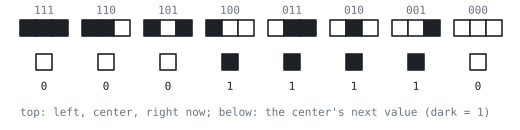

# 10.11 rule30

**New concept:** a different neighbourhood rule.

Rule 30 looks simple but produces chaotic patterns. Mathematica used it as a
random number generator.

**Coming from Verilog:** Same idea.

## Task

Same as `rule90`, but the next state of cell `i` is `left XOR (center OR right)`,
with `left = q(i+1)`, `center = q(i)`, `right = q(i-1)`, and `'0'` beyond the ends.



## Ports

```vhdl
entity top_module is
  port (
    clk, load : in  std_logic;
    d         : in  std_logic_vector(63 downto 0);
    q         : out std_logic_vector(63 downto 0)
  );
end entity top_module;
```

## Hints

<details><summary>Hint 1</summary>

Build `left` and `right` vectors by shifting `q` with zero fill.

</details>

## Check

```
./check.py 10.11
```
