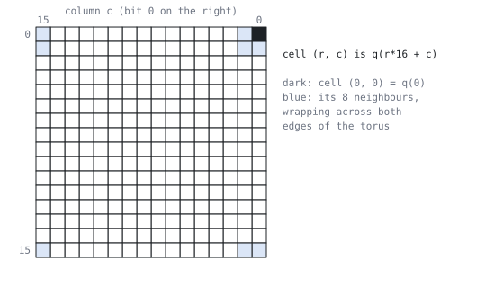

# 10.12 life16

**New concept:** 2-D indexing on a flattened vector; generate loops over two dimensions.

A 2-D grid flattened into a vector is indexed as `row * WIDTH + col`. With
wraparound (a torus), neighbour coordinates are taken `mod` the grid size.

Nested `for` loops in a clocked process (or nested `for ... generate`) visit every
cell. Count each cell's live neighbours with a variable, then apply the rule.

**Coming from Verilog:** Same indexing; `%` is `mod`.

## Task

Conway's Game of Life on a 16×16 torus (edges wrap in both directions). Cell
`(r, c)` is bit `r*16 + c` of `q`. On an edge with `load = '1'`, load `d`;
otherwise advance one generation:

- a live cell with 2 or 3 live neighbours stays alive, otherwise it dies
- a dead cell with exactly 3 live neighbours becomes alive

Each cell has 8 neighbours. No reset.



## Ports

```vhdl
entity top_module is
  port (
    clk, load : in  std_logic;
    d         : in  std_logic_vector(255 downto 0);
    q         : out std_logic_vector(255 downto 0)
  );
end entity top_module;
```

## Hints

<details><summary>Hint 1</summary>

A helper function `cell(r, c)` that returns `q(((r mod 16) * 16) + (c mod 16))` keeps the loop readable. Pass `r + 15` instead of `r - 1` so the argument stays natural.

</details>

## Check

```
./check.py 10.12
```
