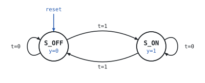

# 11.1 fsm_toggle

**New concept:** enum state type, two-process FSM.

A finite state machine in VHDL starts with an enumerated state type. The tools
pick the encoding (binary, one-hot, …), and the waveform shows state *names*.

Throughout this section, the recommended pattern is:

```vhdl
type state_t is (IDLE, BUSY, FINISH);
signal state, next_state : state_t;
...
-- 1. state register
process(clk)
begin
  if rising_edge(clk) then
    if reset = '1' then
      state <= IDLE;
    else
      state <= next_state;
    end if;
  end if;
end process;

-- 2. next-state and output logic
process(all)
begin
  next_state <= state;          -- default: stay
  done_flag  <= '0';            -- default outputs
  case state is
    when IDLE   => if go = '1' then next_state <= BUSY; end if;
    when BUSY   => ...
    when FINISH => done_flag <= '1'; next_state <= IDLE;
  end case;
end process;
```

A single clocked process that does everything is also fine, and often shorter for
small machines. Outputs that must be registered (one cycle after the event) come
naturally from that style.

**Coming from Verilog:** No more `localparam` state codes or `reg [1:0] state`: declare a `type` and let the tools encode it.

## Task

Two states, off and on. At every rising edge where `t = '1'`, switch state.
The output `y` is `'1'` in the on state (a Moore output: it depends only on the
state). Active-high synchronous `reset` → off.

Careful with names: `on` is a reserved word in VHDL (as in `wait on clk`), so
`type state_t is (OFF, ON);` doesn't compile. Use names like `S_OFF`, `S_ON`.



## Ports

```vhdl
entity top_module is
  port (
    clk, reset, t : in  std_logic;
    y             : out std_logic
  );
end entity top_module;
```

## Hints

<details><summary>Hint 1</summary>

`y <= '1' when state = S_ON else '0';`

</details>

## Check

```
./check.py 11.1
```
