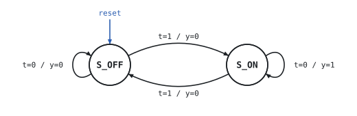

# 11.2 fsm_mealy

**New concept:** Mealy outputs depend on current inputs (checked by the mid-cycle compare).

A **Mealy** output depends on the state *and* the current inputs, so it can change
in the middle of a clock cycle when an input changes. The grader compares outputs
right after the inputs change, so a registered (Moore) version fails here.

**Coming from Verilog:** Same as an output computed in `always @(*)` from state and inputs.

## Task

Same states and transitions as 11.1, but `y = '1'` when the state is on **and** `t = '0'` in the current cycle.



## Ports

```vhdl
entity top_module is
  port (
    clk, reset, t : in  std_logic;
    y             : out std_logic
  );
end entity top_module;
```

## Hints

<details><summary>Hint 1</summary>

`y <= '1' when state = S_ON and t = '0' else '0';`

</details>

## Check

```
./check.py 11.2
```
