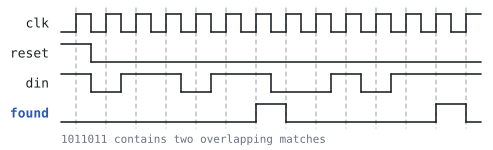

# 11.3 seq_1011

**New concept:** sequence detector with overlap.

A sequence detector has one state per prefix of the pattern matched so far. On a
mismatch, it doesn't always go back to the start: it goes to the longest suffix of
what it has seen that is still a prefix of the pattern. That's what allows
overlapping matches.

**Coming from Verilog:** Same design method.

## Task

`din` is sampled at each rising edge. `found` is `'1'` during the cycle after the
edge at which the last four samples were `1, 0, 1, 1` (oldest first). It's a Moore
output. Overlap is allowed: the stream `1011011` produces two detections.
Active-high synchronous `reset` forgets everything received so far.



## Ports

```vhdl
entity top_module is
  port (
    clk, reset, din : in  std_logic;
    found           : out std_logic
  );
end entity top_module;
```

## Hints

<details><summary>Hint 1</summary>

Five states: nothing, `1`, `10`, `101`, `1011`.

</details>

<details><summary>Hint 2</summary>

From `1011`, a `1` leads to state `1` and a `0` leads to state `10`.

</details>

## Check

```
./check.py 11.3
```
