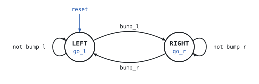

# 11.4 walker

**New concept:** states with priorities between inputs.

When several inputs can trigger transitions at once, write the priority into the
order of the `if`/`elsif` chain, and handle the "both" case explicitly first.

**Coming from Verilog:** Same.

## Task

A walker goes `LEFT` or `RIGHT`. At each rising edge:

- `bump_l` and `bump_r` both `'1'`: reverse direction
- only `bump_l`: go (or keep going) `RIGHT`
- only `bump_r`: go (or keep going) `LEFT`
- neither: keep going

Outputs are one-hot: `go_l` is `'1'` in `LEFT`, `go_r` in `RIGHT`.
**Asynchronous** active-high reset `areset` → `LEFT`.



## Ports

```vhdl
entity top_module is
  port (
    clk, areset, bump_l, bump_r : in  std_logic;
    go_l, go_r                  : out std_logic
  );
end entity top_module;
```

## Hints

<details><summary>Hint 1</summary>

The state register process tests `areset` before `rising_edge(clk)`.

</details>

## Check

```
./check.py 11.4
```
