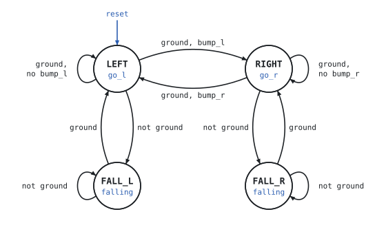

# 11.5 walker_fall

**New concept:** adding states without breaking existing behavior.

Extending an FSM usually means adding states rather than flags. Here the walker
needs to remember which way it was going while it falls, which is two new states,
not one.

**Coming from Verilog:** Same.

## Task

Extend 11.4 with a `ground` input. At each rising edge:

- walking and `ground = '0'`: start falling (bumps are ignored on this edge)
- walking and `ground = '1'`: same rules as 11.4
- falling and `ground = '0'`: keep falling (bumps ignored)
- falling and `ground = '1'`: resume walking in the direction it was going
  before the fall (bumps ignored on this edge)

While falling, `go_l = go_r = '0'` and `falling = '1'`. Asynchronous active-high
reset `areset` → walking `LEFT`.



## Ports

```vhdl
entity top_module is
  port (
    clk, areset, bump_l, bump_r, ground : in  std_logic;
    go_l, go_r, falling                 : out std_logic
  );
end entity top_module;
```

## Hints

<details><summary>Hint 1</summary>

Four states: `LEFT`, `RIGHT`, `FALL_L`, `FALL_R`.

</details>

## Check

```
./check.py 11.5
```
