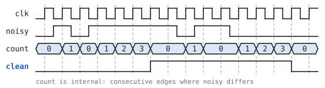

# 11.6 debounce

**New concept:** counter inside an FSM.

Mechanical switches bounce for milliseconds. A debouncer only accepts a new level
after it has been stable for a while. A small counter does the timing; it
restarts whenever the input agrees with the current output.

**Coming from Verilog:** Same.

## Task

At each rising edge, compare `noisy` with `clean`:

- if they're equal, the counter restarts
- if they differ, the counter advances, and at the **4th consecutive edge** where
  they differ, `clean` takes the value of `noisy` (and the counter restarts)

`clean` is a registered output. Active-high synchronous `reset` → `clean = '0'`,
counter restarted.



## Ports

```vhdl
entity top_module is
  port (
    clk, reset, noisy : in  std_logic;
    clean             : out std_logic
  );
end entity top_module;
```

## Hints

<details><summary>Hint 1</summary>

A counter `0 to 3`: flip `clean` when it is already 3 and the inputs still differ.

</details>

## Check

```
./check.py 11.6
```
