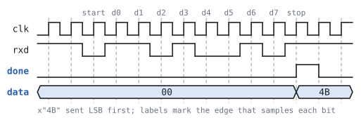

# 11.7 uart_rx_byte

**New concept:** framing FSM with a datapath.

Real protocols combine an FSM (where am I in the frame?) with a datapath (a shift
register and a bit counter). Keep the bit counter as an integer signal alongside
the state.

The line `rxd` idles at `'1'` and carries one bit per clock (no oversampling): sample
it once at every rising edge.

**Coming from Verilog:** Same structure.

## Task

- **Idle**: wait for a `'0'` (the start bit).
- **Data**: the next 8 samples are the data bits, LSB first.
- **Stop**: the next sample is the stop bit.
  - `'1'`: at that edge, copy the byte to `data` and set `done` (high for exactly
    the next cycle), then go back to idle (the very next sample may already be a
    new start bit).
  - `'0'`: framing error. Don't touch `data` or `done`; wait until a `'1'` is
    sampled, then go back to idle (that `'1'` can't also be a start bit).

`done` is `'0'` after every other edge. `data` holds its value until the next good
frame. Active-high synchronous `reset` → idle, `data = x"00"`, `done = '0'`.



## Ports

```vhdl
entity top_module is
  port (
    clk, reset, rxd : in  std_logic;
    data            : out std_logic_vector(7 downto 0);
    done            : out std_logic
  );
end entity top_module;
```

The grader feeds a mix of well-formed frames, frames with a bad stop bit, idle line, and noise.

## Hints

<details><summary>Hint 1</summary>

States: `IDLE`, `DATA` (with a bit counter 0–7), `STOP`, `WAIT_IDLE`.

</details>

<details><summary>Hint 2</summary>

Shift right with the new bit entering at the top: after 8 shifts the first bit is in bit 0.

</details>

## Check

```
./check.py 11.7
```
