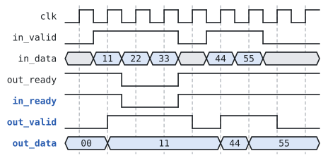

# 11.8 handshake_fifo1

**New concept:** valid/ready handshake, a one-entry buffer.

In a **valid/ready** handshake, a transfer happens on a clock edge where both
`valid` (from the sender) and `ready` (from the receiver) are `'1'`. The sender
must hold its data until then.

A one-entry buffer is ready when it's empty, or when its current entry is being
taken this very cycle. That second condition is combinational from the
downstream `out_ready`, which lets data flow every cycle.

**Coming from Verilog:** Same protocol as AXI-Stream's TVALID/TREADY.

## Task

One-entry buffer:

- `out_valid = '1'` whenever the buffer holds an entry, with the entry on `out_data`
- `in_ready = '1'` when the buffer is empty **or** `out_ready = '1'` (drained this cycle)
- at a rising edge, the entry leaves if `out_valid = '1'` and `out_ready = '1'`,
  and `in_data` is stored if `in_valid = '1'` and `in_ready = '1'`; both can happen
  on the same edge
- `out_data` keeps the last stored value while the buffer is empty

Active-high synchronous `reset` → empty, `out_data = x"00"`.



## Ports

```vhdl
entity top_module is
  port (
    clk, reset, in_valid, out_ready : in  std_logic;
    in_data                         : in  std_logic_vector(7 downto 0);
    in_ready, out_valid             : out std_logic;
    out_data                        : out std_logic_vector(7 downto 0)
  );
end entity top_module;
```

## Hints

<details><summary>Hint 1</summary>

State is one `full` flag plus the stored byte. `in_ready <= not full or out_ready;`

</details>

## Check

```
./check.py 11.8
```
