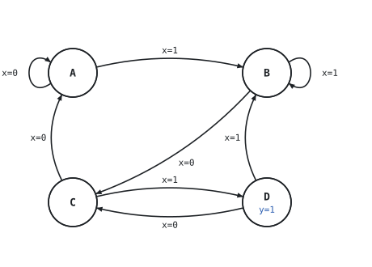

# 11.9 onehot_next_state

**New concept:** deriving next-state equations by hand for a one-hot encoding.

With one-hot encoding, each state has its own flip-flop. The next-state logic for
state `S` is just "OR over every transition that enters `S`": for each source
state and input condition that leads to `S`, AND the source's bit with the
condition.

**Coming from Verilog:** Same derivation.

## Task

This 4-state machine has input `x` and Moore output `y` (high in `D`):

| state | next if `x = 0` | next if `x = 1` |
|---|---|---|
| A | A | B |
| B | C | B |
| C | A | D |
| D | C | B |

`state` is one-hot (`state(0)` = A, `state(1)` = B, `state(2)` = C, `state(3)` = D).
Output the one-hot next state `nxt` and `y`. This is purely combinational.



## Ports

```vhdl
entity top_module is
  port (
    state : in  std_logic_vector(3 downto 0);
    x     : in  std_logic;
    nxt   : out std_logic_vector(3 downto 0);
    y     : out std_logic
  );
end entity top_module;
```

The grader only drives one-hot values on `state`.

## Hints

<details><summary>Hint 1</summary>

`nxt(0)` (A) is entered from A and C when `x = 0`: `(state(0) or state(2)) and not x`.

</details>

## Check

```
./check.py 11.9
```
