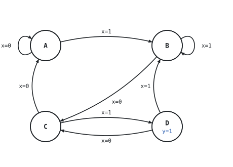

# 11.10 binary_next_state

**New concept:** the same machine with binary encoding.

With a binary encoding the next-state logic is a lookup on the state code and the
input. A `case` on the state code is the direct translation.

**Coming from Verilog:** Same.

## Task

Same table as 11.9, but `state` is binary-encoded (A = `00`, B = `01`, C = `10`, D = `11`). Output the binary next state `nxt` and `y` (high in D).



## Ports

```vhdl
entity top_module is
  port (
    state : in  std_logic_vector(1 downto 0);
    x     : in  std_logic;
    nxt   : out std_logic_vector(1 downto 0);
    y     : out std_logic
  );
end entity top_module;
```

## Hints

<details><summary>Hint 1</summary>

A `case` on `state` with an `if x` in each branch.

</details>

## Check

```
./check.py 11.10
```
